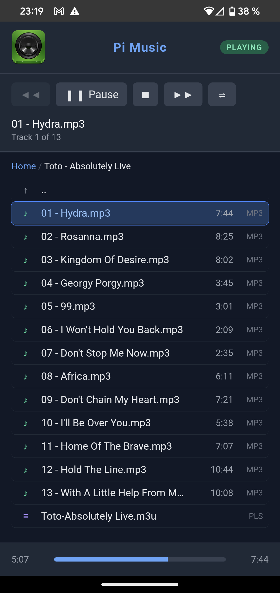

# PiMusic
Version 1.0.1


A lightweight web-based music player for Raspberry Pi. Browse a local or NAS-mounted music library from any browser on your network and play music through the Pi's audio output using mpg123 or mplayer.

No streaming to the device yet. 

Runs on a **Raspberry Pi 1B** — and newer versions as well as on any other hardware using Linux.



## Features
- Browse nested folders of music files, M3U and PLS playlists
- Play internet radio streams from PLS/M3U playlists
- Displays live ICY stream metadata (artist / track title) for internet radio
- Previous / next track navigation, shuffle
- Track durations shown in the file list — retrieved in the background via `mediainfo` while the player is idle, cached to disk and restored on restart
- Files with leading track numbers sort numerically (1, 2, 10 … not 1, 10, 2)
- Single-click to select, double-click to play
- Star any track to add it to `favorites.m3u` in your music folder
- Locator button jumps the browser to the folder of the playing track
- Automatically advances to the next track when a song finishes
- Progress bar with seek by click
- Responsive layout — works on desktop and mobile (portrait and landscape)
- Installable as a PWA — add to Android or iOS home screen for a native app feel
- Runs as a systemd service, starts on boot

## Requirements

- Raspberry Pi running a Linux distribution with systemd (tested on Pi 1B)
- Python 3.7 or newer
- Flask
- `mediainfo` — for track duration display
- One of the supported audio backends (see below)

## Audio backends

PiMusic supports two backends, configured in `pimusic.conf`:

| Backend              | `backend =` value | Supported formats                                   |
|----------------------|-------------------|-----------------------------------------------------|
| **mpg123** (default) | `mpg123`          | MP3                                                 |
| **mplayer**          | `mplayer`         | MP3, OGG, FLAC, AAC, WAV, M4A, WMA, Opus and more  |

Switch backend by editing `pimusic.conf`:

```ini
[player]
backend = mplayer
```

With `mpg123`, unsupported formats are silently skipped in the file browser. With `mplayer`, all formats mplayer understands are playable.

## Favorites

Every audio row in the browser carries a star on the right:

| Star | Meaning                   |
|------|---------------------------|
| ☆    | not a favorite            |
| ★    | listed in `favorites.m3u` |

Tapping it adds or removes the track. The list lives in `favorites.m3u` in the root of your music folder, so it appears in the browser as a normal playlist and plays like any other:

```
#EXTM3U
AC-DC - T.N.T. [Live].mp3
Led Zeppelin IV/15 - Stairway to Heaven (1971).mp3
```

Folders and playlists get no star — only playable audio files. The music folder must be writable by the user the service runs as; if it is not, the star springs back and the reason appears both on screen and in the log.

## Finding the playing track

The player bar carries a locator button (⌖) to the right of the track name:

| Appearance | Meaning                                            |
|------------|----------------------------------------------------|
| Blue       | click to open the folder holding the playing track |
| Dimmed     | nothing is playing                                 |

The track it jumps to is highlighted and scrolled into view. This matters for playlists such as `favorites.m3u`, whose tracks live in different folders — the browser never follows playback on its own, so your place in the library is never pulled out from under you.

## Installation

Two exclusive paths — take one. Ansible runs from your dev machine and does everything the four manual steps do, dependencies included; the manual path does each step explicitly on the device.

### Deploy with Ansible

```bash
cd ansible
cp inventory.ini.example inventory.ini   # hostname, SSH user, deploy path, music root
ansible-playbook deploy.yml -K           # full install
ansible-playbook update.yml -K           # later: sync changed files and restart
```

`deploy.yml` installs the packages, syncs the sources, writes `pimusic.conf` and `/etc/systemd/system/pimusic.service`, and on a first install enables and starts the service. `update.yml` is the quick code update — it syncs and restarts, nothing else. Prerequisites and details: [ansible/README.md](ansible/README.md).

### Install it manually

#### 1. Copy files to the Pi

From your dev machine:

```bash
rsync -av src/ <user>@<pi-ip>:~/pimusic/
```

Or run this on the Pi itself, pulling from the dev machine:

```bash
scp -r <dev-user>@<dev-ip>:~/git/PiMusic/src/* ~/pimusic/
```

#### 2. Install dependencies

**Debian / Raspberry Pi OS**

```bash
sudo apt install python3-flask mediainfo mpg123    # mpg123 backend
sudo apt install python3-flask mediainfo mplayer   # mplayer backend
```

**Arch / Manjaro ARM**

```bash
sudo pacman -S python-flask mediainfo mpg123       # mpg123 backend
sudo pacman -S python-flask mediainfo mplayer      # mplayer backend
```

If your distro does not provide these packages, install via pip:

```bash
pip install -r ~/pimusic/requirements.txt
```

#### 3. Configure the music folder

Edit `~/pimusic/pimusic.conf`:

```ini
[music]
# Full path to the folder containing your music files and playlists.
root = /mnt/music

[server]
host = 0.0.0.0
port = 5054
```

Set `root` to wherever your music lives — a local folder or a NAS mount point. The folder must be accessible when the service starts.

#### 4. Install and start the systemd service

Edit `~/pimusic/pimusic.service` to match your username and deploy path:

```ini
[Service]
User=<user>
WorkingDirectory=/home/<user>/pimusic
ExecStart=/usr/bin/python3 /home/<user>/pimusic/app.py
```

Then install it:

```bash
sudo cp ~/pimusic/pimusic.service /etc/systemd/system/
sudo systemctl enable pimusic
sudo systemctl start pimusic
```

Check that it started correctly:

```bash
sudo systemctl status pimusic
```

## Usage

Open a browser and go to `http://<pi-ip>:5054`.

| Action | How |
|--------|-----|
| Select a file | Single click |
| Play | Double-click, or single-click then **▶ Play** |
| Pause / Resume | **⏸ / ▶** button |
| Stop | **■** button |
| Previous / Next track | **◀◀ / ▶▶** (local playlists only) |
| Shuffle | **⇄** button |
| Seek | Click anywhere on the progress bar |
| Favorite / unfavorite | **☆ / ★** star at the right of the row |
| Find the playing track | **⌖** button in the player bar |

Previous / next and shuffle are disabled for internet radio streams.

### Track durations

Durations are fetched in the background by `mediainfo` the first time you browse the library. The retriever runs only while the player is idle, so playback is never interrupted. Progress is visible in the file list as durations appear one by one. On a large NAS library this can take a while — durations are cached to `duration_cache.json` and reloaded instantly on every subsequent start.

### Installing as a PWA (Android / iOS)

Open the player in Chrome or Safari on your phone and use **Add to Home Screen** from the browser menu. PiMusic will appear as an app icon and open in standalone mode without the browser chrome.

## File structure

Both installation paths end with the same layout on the device:

```
/home/<user>/pimusic/
  app.py                      Flask web server and API
  player.py                   audio backend (mpg123 / mplayer)
  config.py                   reads pimusic.conf
  OSTools.py                  rotating log helper
  pimusic.conf                configuration — edit this
  requirements.txt            Python dependencies
  templates/
    index.html                web UI
  static/
    style.css                 styling
    app.js                    browser logic
    site.webmanifest          PWA manifest
    icon-512.png              header icon
    apple-touch-icon.png
    android-chrome-192x192.png
    android-chrome-512x512.png
    favicon.ico
    favicon-32.png
    favicon-16.png

/etc/systemd/system/
  pimusic.service             the service, enabled for boot
```

These appear later, while the player runs:

```
/home/<user>/pimusic/duration_cache.json   cached track durations
/home/<user>/pimusic/PiMusic.log           log, with log_console = true
/home/<user>/pimusic/__pycache__/          byte code
~/.config/PiMusic/PiMusic.log              log, with log_console = false
<music root>/favorites.m3u                 written by the star button
```

## Troubleshooting

**Empty browser / red error message** — the music root is not set or not mounted. Check `pimusic.conf` and verify the path exists on the Pi.

**No sound** — confirm your backend works from the command line (`mpg123 /path/to/file.mp3` or `mplayer /path/to/file.mp3`). Check the Pi's audio output is configured correctly.

**No track durations** — confirm `mediainfo` is installed (`mediainfo --version`). On a NAS, the first scan may take a long time as the drive spins up for each file; leave the service running overnight.

**Service won't start** — check the log: `sudo journalctl -u pimusic -n 50`.
